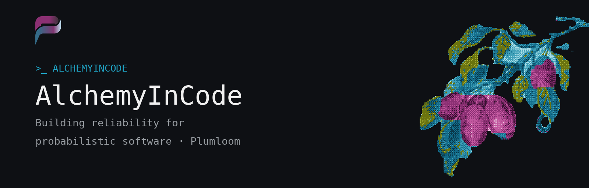
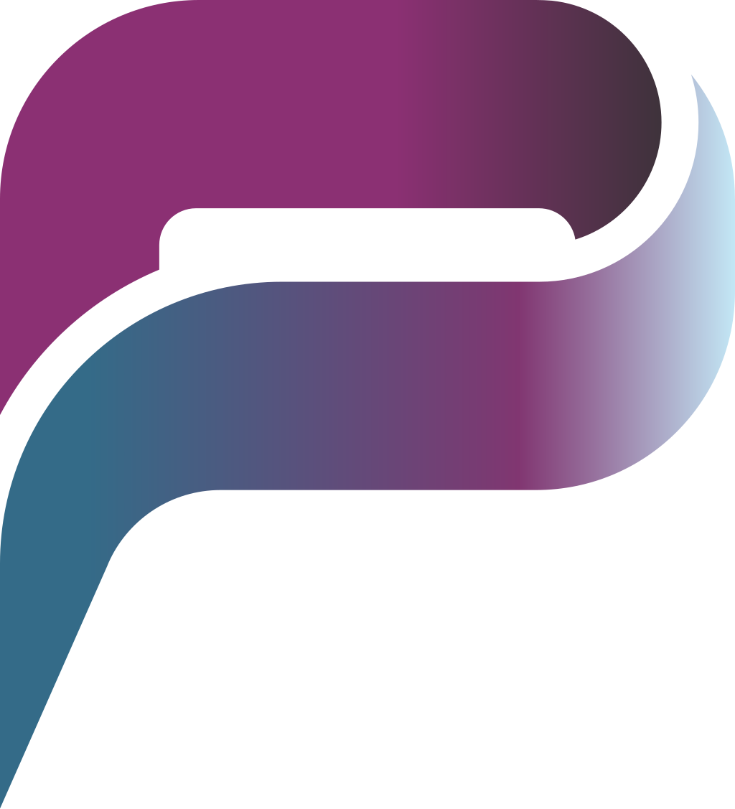

<p align="center">
  <picture>
    <source media="(prefers-color-scheme: light)" srcset="assets/profile-banner-light.png" />
    
  </picture>
</p>

<p align="center">
  <code>&gt;_ ALCHEMYINCODE / PLUMLOOM</code>
</p>

### Hi, I build reliability for probabilistic software.

I work on [**Plumloom**](https://plumloom.ai) — tooling that gives AI teams real evidence behind a release decision, not a single lucky score.
<!-- TODO: add 1–2 lines about yourself (role, location, what you're exploring) -->

```text
$ whoami
> builder @ plumloom · AI evaluation · release gating · MCP tooling
```

---

### Featured project

<table>
<tr>
<td width="100%">

**[`plumloom-autoeval-oss`](https://github.com/AlchemyInCode/plumloom-autoeval-oss)** — The release-confidence layer for AI-agent changes.

Open-source CLI and MCP server that turns committed eval files into gated CI checks, with confidence intervals and consistency statistics.


</td>
</tr>
</table>

### Stack

<p>
  
  
  
  
  
  
  
</p>
<!-- TODO: adjust to your actual stack -->

### Connect

<p>
  <a href="https://plumloom.ai"></a>
  <a href="https://plumloom.ai/research"></a>
  <a href="https://huggingface.co/Plumloom"></a>
  <a href="https://plumloom.ai/free-pilot"></a>
  <a href="https://plumloom.ai/contact"></a>
  <a href="https://www.linkedin.com/in/spatialthinker"></a>
  <a href="https://x.com/spatialthinker8"></a>
</p>

<p align="center"></p>

<sub>A single evaluation tells you what happened. Repeated evaluation tells you what would happen again.</sub>
